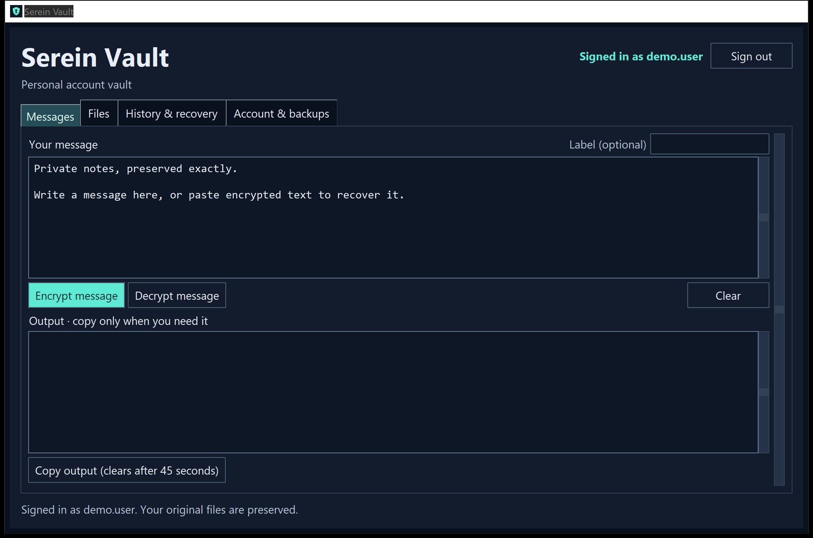
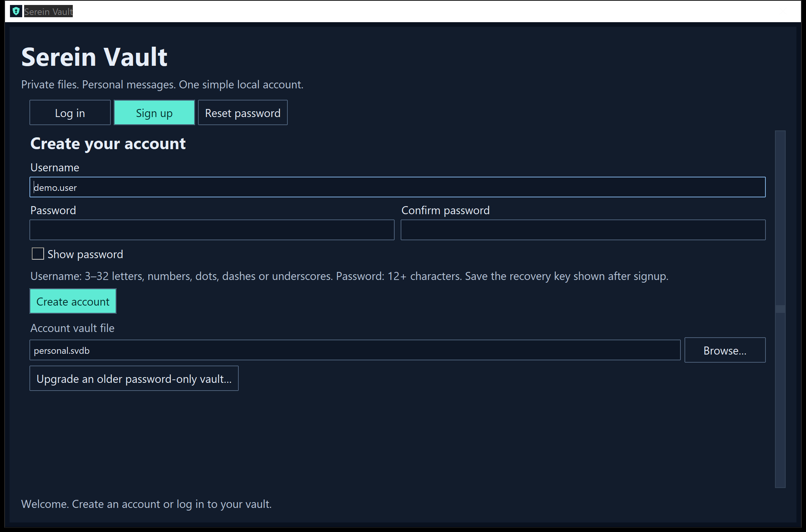
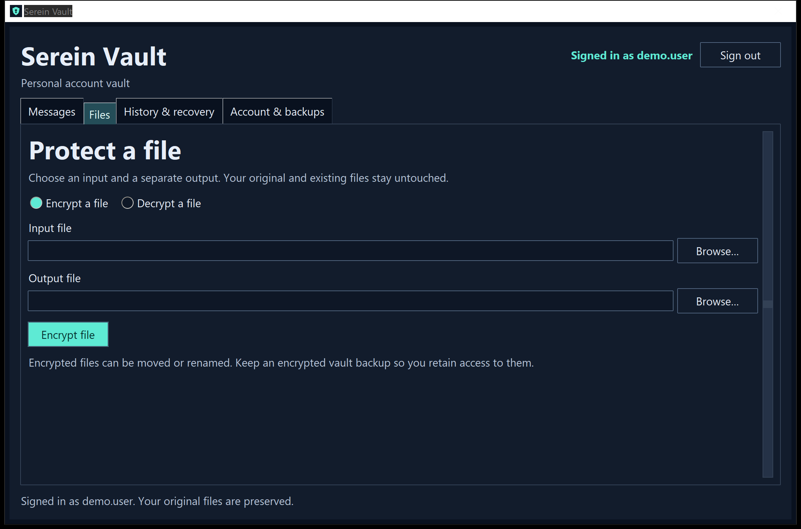
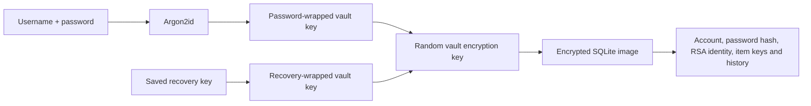

# Serein Vault

**A simple, dark-mode desktop app for protecting files and personal messages.**

**Academic status:** repaired, improved, modernized, and validated locally plus in hosted Windows/Linux CI for academic demonstration and review. [Readiness assessment](development-plans/ACADEMIC-READINESS.md) records completed scope and remaining acceptance checks.

I rebuilt my original **EncryptZone** academic project as Serein Vault. My goal is to keep the code understandable enough to study while fixing the original key-storage and data-loss problems. I use Python, Tkinter, SQLite, uv, and one runtime dependency: PyCA `cryptography`.

Each encrypted vault has **one local owner account** with a username, password, and recovery key. The app does not need a web server, email provider, or online identity service.

**Version:** 1.2.0 · **Author:** [Faraz Hussain](https://github.com/asteroidcrib729) · **License:** [MIT](LICENSE) · **Python:** 3.14.7



## Navigation

- [Features](#features)
- [Install and run](#install-and-run)
- [Windows installers](#windows-installers)
- [Signup and login](#signup-and-login)
- [Password resets and recovery keys](#password-resets-and-recovery-keys)
- [Messages and files](#messages-and-files)
- [Backups and account settings](#backups-and-account-settings)
- [Accessibility and keyboard controls](#accessibility-and-keyboard-controls)
- [Security architecture](#security-architecture)
- [Existing vaults and legacy data](#existing-vaults-and-legacy-data)
- [Project structure](#project-structure)
- [Development and validation](#development-and-validation)
- [Development plans](#development-plans)
- [License and attribution](#license-and-attribution)

## Features

| Area | Current behavior |
| --- | --- |
| Accounts | Signup, username/password login, sign out, and recovery-key password reset |
| Authorization | The signed-in owner can access their vault; signed-out sessions cannot run data operations |
| Messages | Encrypt exact text, decrypt pasted tokens, save/edit labels, search history, and recover earlier messages |
| Files | Stream to a separate output with byte progress and safe cancellation while preserving original and existing files |
| Storage | Encrypt all SQLite pages, including account details, password hash, public/private keys, and key history |
| Recovery | Replace recovery keys, verify vault health, create encrypted backups, upgrade password-only vaults, and import prototype keys |
| Interface | Tkinter/ttk only, dark navy/teal palette, DPI-aware text, visible focus, inline feedback, precision touchpad scrolling, and keyboard navigation |
| Distribution | Local EXE/MSIX builds, source/artifact checksums, installer probes, and GitHub Actions workflows |

I keep one owner per vault instead of adding a multi-user administration system. Different vault files can hold different accounts. A username identifies the owner of a selected file; it is not globally registered, and the same username can exist in another file.

## Install and run

Install [uv](https://docs.astral.sh/uv/getting-started/installation/), open a terminal in the repository, then run:

```powershell
uv python install 3.14.7
uv sync --locked
uv run --locked python -m serein_vault
```

`.python-version` pins **Python 3.14.7**. uv creates `.venv` and installs the versions in `uv.lock`. Your desktop Python distribution must include Tk/Tcl. The Windows installation used for local validation provides Tk 9.0.

After syncing, these entry points also work:

```powershell
uv run --locked python main.py
uv run --locked serein-vault
```

The old `main.py.exe` is deprecated. It is never used to build the current application.

### VS Code

Open this repository folder and run **Terminal → Run Task → Serein: sync environment**, or use `uv sync --locked --group packaging`. The workspace points Python and the debugger to `.venv/Scripts/python.exe`, enables pytest discovery, and recommends Python, Pyrefly, Ruff, and the Python debugger. No nonexistent environment file or unrelated diagnostic suppression is configured.

If VS Code has cached an older interpreter, run **Python: Select Interpreter** once and choose the project's `.venv`. `python.defaultInterpreterPath` supplies the workspace default; it does not override a selection VS Code already saved. The supplied debugger has Linux/macOS path overrides. See [VS Code environment guidance](https://code.visualstudio.com/docs/python/environments).

### After moving or renaming the repository

The source and VS Code settings use workspace-relative paths, but a moved virtual environment can retain the previous absolute path in editable installs, launchers, and activation scripts. From the new repository root, refresh it without changing locked dependency versions:

```powershell
uv --cache-dir .uv-cache venv --allow-existing --python 3.14.7 --offline .venv
uv --cache-dir .uv-cache sync --locked --group packaging --reinstall --offline
```

The first command refreshes uv-generated activation scripts while preserving installed packages. The second regenerates the editable installation and executable launchers. `--offline` uses the existing interpreter/package cache; omit it if those are not available. Reopen VS Code in the renamed folder, select its `.venv` interpreter if needed, and open a fresh terminal.

Existing vaults remain in the normal user-data directory or their explicitly chosen location. Historical build reports keep the paths recorded when those artifacts were built; new builds record the new root. Renaming this local directory does not rename the GitHub repository or change its remote URL.

## Windows installers

I provide reproducible build commands and CI workflows for **x64 Windows EXE setup** and **MSIX preview packages**. Build locally with Python 3.14.7, uv, and Windows SDK MakeAppx installed:

```powershell
uv --cache-dir .uv-cache sync --locked --group packaging
uv --cache-dir .uv-cache run --locked --group packaging python packaging/build_windows.py
```

Use `--format exe` or `--format msix` for one format. The EXE build uses a verified local Inno Setup bootstrap. A build creates a timestamped folder inside **`packaged-releases/`** containing installers, license/author credit, smoke reports, provenance, and SHA-256 checksums. Intermediate files stay in `.packaging-build/`; both directories are ignored in Git. Build-only Pillow and PyInstaller are separate from the application's runtime dependencies.

The EXE installs per user and preserves vaults/user files on uninstall. Local validation exercises actual installation, the installed GUI/backend, and uninstall with disposable data. It does not require another Python installation at runtime, although a separate clean-machine acceptance check remains open.

Both formats are **unsigned**. The MSIX needs a valid, trusted signing identity before ordinary installation; its current checks cover schema, block hashes, and extracted-runtime functionality. Signing, trusted MSIX installation, and public release publication remain separate steps. I have not changed certificate trust. The installer workflows can create unpublished GitHub draft releases after successful builds; a draft is not a public release.

[Complete packaging and verification instructions](development-plans/PACKAGING.md) · [EXE workflow](.github/workflows/windows-exe.yml) · [MSIX workflow](.github/workflows/windows-msix.yml)

### CI builds and release drafts

Both installer workflows have a **build -> draft** dependency. Main/tag pushes create an unpublished draft after successful build checks. Manual dispatch offers **create_draft** (default true); set it false for artifacts only. Pull requests build/test without creating releases.

Each format gets a distinct preview tag containing format, source SHA, workflow run ID and attempt. Draft creation requires clean, matching provenance, complete checksums and successful smoke reports; the EXE additionally requires installed-app/uninstall evidence. Uploaded file sizes and GitHub SHA-256 digests are checked. Drafts remain unpublished and include the installer, license, AUTHORS, checksums and evidence.

Workflows do not commit source changes. Their Git identity defaults name **Faraz Hussain** as author and **github-actions[bot]** as committer for any future workflow-generated commit. Draft-release creation does not create a code commit.

[Validation CI](https://github.com/asteroidcrib729/serein-vault/actions/workflows/ci.yml) ? [EXE build/draft](https://github.com/asteroidcrib729/serein-vault/actions/workflows/windows-exe.yml) ? [MSIX build/draft](https://github.com/asteroidcrib729/serein-vault/actions/workflows/windows-msix.yml)

## Signup and login

### Create an account

1. Choose **Sign up**.
2. Enter a username of 3–32 letters, numbers, dots, dashes, or underscores. Start with a letter or number.
3. Enter and confirm a password/passphrase of 12–1024 characters, including a non-whitespace character.
4. Keep the default vault path or browse to a new `.svdb` filename. Signup refuses existing files.
5. Choose **Create account**, then save the displayed recovery key in a password manager or offline location, separately from the vault.
6. Confirm that you saved it and continue to the workspace.

Usernames ignore case and surrounding whitespace: ` My.Name ` becomes `my.name`. Passwords preserve Unicode, case, leading/trailing spaces, and every other character exactly. Secret fields are masked by default; **Show password** lets you check your input explicitly.

### Log in or switch accounts

Choose **Log in**, select the correct vault file, and enter its username and password. Use **Sign out** before opening another account. No plaintext account index or username directory is written to disk.

Default storage does not depend on your terminal's working directory:

| Platform | Default account vault |
| --- | --- |
| Windows | `%LOCALAPPDATA%\SereinVault\vault.svdb` |
| macOS | `~/Library/Application Support/SereinVault/vault.svdb` |
| Linux | `$XDG_DATA_HOME/SereinVault/vault.svdb`, falling back to `~/.local/share/SereinVault/vault.svdb` |

The interface signs out after **10 minutes of inactivity**. Closing during a cancellable file operation requests safe cancellation; other operations finish safely before the session is released.

## Password resets and recovery keys



A username alone cannot recover encrypted data. I generate a **256-bit recovery key** as a second way to unlock the vault's encryption key. It is shown after signup, an upgrade, a reset, or explicit replacement. No plaintext recovery-key file is saved automatically.

To reset a forgotten password:

1. Choose **Reset password** and select the correct `.svdb` file.
2. Enter your username, saved recovery key, and a new password twice.
3. Choose **Reset password**.
4. Save the **replacement recovery key**. The previous key no longer resets the updated file.
5. Continue to **Log in** using the username and new password.

Reset preserves the existing RSA identity, item keys, message history, and access to encrypted files. It cannot repair corrupted ciphertext. If you lose the recovery key while still knowing the password, sign in and use **Account & backups → Replace recovery key**, entering your current password.

If both password and recovery key are lost, the username cannot bypass encryption. There are no security questions, default credentials, or administrator reset backdoors. Older backup files retain their older passwords and recovery keys; updating the current vault does not revoke separate copies. Make and verify a fresh encrypted backup after changes.

## Messages and files

### Messages

Enter text in **Messages** and choose **Encrypt message**. The output begins with `SEREIN1:`. To decrypt it, paste the token into the input and choose **Decrypt message**. The actual pasted token is read; the app does not substitute a message from another file.

Whitespace, Unicode, line breaks, and tabs are preserved. Messages support 1 byte to 1 MiB of UTF-8 text. Every successful encryption retains its key/history record. In **History & recovery**, select a message to load its token or recover its plaintext; the app switches to Messages for you.

An optional **Label** of up to 80 characters helps identify a message. Use **Edit message label** on a selected history message to change it. Labels stay inside encrypted SQLite and do not alter the token or message contents. **Search history** filters type, label, and creation date case-insensitively, including Unicode case folding. Search is local and literal; no plaintext search index is written. File history keeps its original filename label.

### Files



In **Files**, choose encryption or decryption, select the input, review the separate output path, and start. Encryption suggests `.svault`; decryption suggests a separate `.recovered` file.

- Inputs are never rewritten; existing outputs are never replaced, including publication-time collisions.
- Serein-encrypted files are rejected as encryption inputs to avoid accidental double encryption.
- Renaming/moving an encrypted file does not break recovery with its original vault.
- Contents are processed in 1 MiB chunks on a worker, with byte counts and a percentage displayed in the window.
- Decrypted output is published only after authenticating the complete file.
- **Cancel** requests cleanup between chunks and before publication. The source remains intact, and handled cancellations remove temporary output.

Choose a trusted local output directory on a filesystem supporting hard links, such as NTFS or APFS. Unsupported safe publication fails while preserving the input. Cancellation is cooperative: a late request cannot retract an already published file. Cancelling after a recovery-key record was saved can leave a harmless history entry without an output. Legacy Fernet recovery does not offer streaming cancellation. Account and backup operations use an activity indicator rather than file byte progress.

## Backups and account settings

**Account & backups** contains password changes, recovery-key replacement, encrypted backup, vault health, and legacy import. Changing a password requires the current one; resetting while signed out requires the recovery key. A normal password change leaves the existing recovery key valid.

**Check vault health** authenticates the current vault, runs SQLite's quick integrity check, validates the RSA identity, and reports the record count and encrypted file size. It is read-only and makes no automatic repairs. Restore a verified backup if the data is damaged.

Choose **Save encrypted vault backup** to create a separate `.svdb` copy. Test it by opening it with the credentials used when it was created and recovering a sample encrypted item. Existing backup destinations are preserved.

Back up both the vault and important encrypted files. User files are not embedded in SQLite; the vault holds their private recovery identity and key history. This version encrypts to its own vault and does not implement recipient public-key exchange.

## Accessibility and keyboard controls

I use standard Tkinter/ttk controls, persistent labels, high-contrast dark surfaces, visible blue focus, explicit password visibility, and inline errors prefixed with **Error:**. Windows DPI awareness keeps text sharp instead of bitmap-stretching the application. The initial window adapts to screen size; long forms and scaled workspaces scroll, including when focus moves below the visible area. Output supports selection/copy while remaining read-only.

Forms handle Tk 9's native **TouchpadScroll** event, ordinary wheel events, and accumulated small deltas. Text areas and the history table retain their own native scrolling. This fixes the missing precision-event path that prevented two-finger form scrolling. Generated precision events pass on real Tk; validation of a particular physical touchpad/driver remains a separate hardware check. Native file dialogs and window decorations can follow Windows' appearance settings.

| Key | Action |
| --- | --- |
| Tab / Shift+Tab | Move between controls, including message areas |
| Enter | Submit the current account form |
| Ctrl+1–4 | Switch workspace tabs |
| Ctrl+Enter | Encrypt the message input |
| Ctrl+Shift+Enter | Decrypt the message input |
| Ctrl+Shift+L | Sign out |
| Ctrl+A | Select all text in a message area |
| Ctrl+Tab | Insert a literal tab in message input |
| F1 | Shortcut help |

The palette is tested against a **4.5:1** regular-text contrast target and **3:1** focus/field-boundary target, informed by [W3C contrast guidance](https://www.w3.org/WAI/WCAG22/Understanding/contrast-minimum.html). Tests cover real Tab events, minimum dimensions, and simulated 125%, 150%, and 200% font scaling; screenshots were reviewed on the actual 200% Windows display. Screen-reader announcements, physical mixed-monitor behavior, and a separate human keyboard walkthrough remain open. These design checks do not establish accessibility certification.

Clipboard access uses Tkinter. Nothing is copied automatically. App-copied values clear after **45 seconds**, on sign out, or after confirming a saved recovery key, provided the clipboard still contains that value. Clipboard managers/OS history may retain copies.

## Security architecture

I separate account credentials from a randomly generated database encryption key:



| Layer | Implementation |
| --- | --- |
| Account credentials | Argon2id, random salt, 64 MiB memory, three iterations, four lanes; username is bound to password derivation/wrapping |
| Password hash | Separately salted Argon2id PHC hash inside encrypted SQLite |
| Database | Complete SQLite image encrypted using AES-256-GCM under a random master key |
| Recovery | Random recovery key independently wraps the master key; reset replaces wrappers without replacing item identities |
| Items | Fresh AES-256-GCM data key per item; RSA-3072 OAEP/SHA-256 key wrapping |
| Persistence | Atomic encrypted saves, failed-save rollback, lifetime process lock, and external-change detection |
| Authorization | An open session and matching owner are checked before every data/key/import/backup operation |

SQLite exists in memory while logged in. No plaintext SQLite database, WAL, or journal is intentionally stored on disk. Password hashes, usernames, public/private RSA keys, and item keys are inside encrypted SQLite. The small public header contains salts, nonces, and encrypted key wrappers. The vault supports SQLite images up to **64 MiB**; large user files are streamed separately.

`.svdb` is whole-image application encryption, **not a SQLCipher file**. Ordinary SQLite tools cannot open it. Reset changes account credentials while keeping the encryption identity needed for existing items.

An unlocked process necessarily holds secrets in memory; Python cannot guarantee zeroization. Malware, administrators, swap, memory dumps, and clipboard history are outside this boundary. Abrupt termination during file decryption can leave temporary plaintext; handled errors clean temporary files, and deletion is not secure erasure. See [the security design](development-plans/SECURITY.md) for formats, guarantees, and limits.

## Existing vaults and legacy data

**Serein Vault 1.0 password-only files:** choose **Upgrade an older password-only vault**, select the file, choose a username, and enter the original password. An encrypted `.before-account-<id>.svdb` backup is saved before atomically upgrading the original to account format two. Keys, history, and item formats remain compatible. Save the recovery key shown after upgrading. Old version-one copies have no recovery-key reset mechanism.

**Original EncryptZone data:** log in, then explicitly import surviving `File_Keys.json`, `Message_Keys.json`, or `Pass.txt` through **Account & backups**. Imports save inside encrypted SQLite while preserving their sources. Select imported keys/messages in History & recovery to recover data. The [migration guide](development-plans/MIGRATION.md) covers limits and missing-key cases.

The old executable, report, and source are archived under [legacy](legacy/README.md), deprecated and excluded from current distributions. The executable has a `.deprecated` extension. The prototype password hash was removed from the active tree; Git history still contains the original coursework artifacts.

## Project structure

```text
src/serein_vault/
  accounts.py     Username validation and password/recovery key wrappers
  storage.py      Encrypted SQLite, accounts, resets, upgrades, backups
  crypto.py       Message and streaming file encryption
  filesystem.py  Atomic publication and process locking
  service.py      Authorized application operations
  legacy.py       Prototype key import and recovery
  gui.py          Tkinter screens and background worker coordination
  desktop.py      Windows DPI and precision form scrolling
  operations.py   Cooperative cancellation and progress callbacks
  smoke.py        Explicit synthetic installer/runtime validation
  assets/         Multi-resolution application branding
tests/            Regression, GUI and accessibility design checks
development-plans/ Completed work, remaining plans, security, migration and screenshots
packaging/        Windows freeze, installer, provenance and verification scripts
packaged-releases/ Local installers and evidence (generated, Git-ignored)
.github/          Validation, installer workflows and dependency reviews
.vscode/          Project interpreter, debugger, test and formatter settings
legacy/           Deprecated coursework artifacts
```

`VaultApp` owns presentation; `VaultService` enforces the active owner; `EncryptedVault` owns storage; cipher classes handle item encryption. These object-oriented boundaries allow testing without windows. Tk updates stay on the main thread; expensive work uses one worker.

## Development and validation

```powershell
uv sync --locked
uv run --locked ruff check .
uv run --locked ruff format --check .
uv run --locked pytest
uv run --locked pip-audit
uv build --no-sources
```

The current local suite passes **117 tests with no skips**, including twelve draft-release checks for source, checksums, smoke evidence, unpublished state and uploaded digests. Results are recorded in [validation](development-plans/VALIDATION.md). Coverage includes account lifecycle/isolation, resets, rotation, upgrades, exact text recovery, source preservation, tampering, output races, concurrent opens, rollback, legacy import, backup restoration, labels/search, progress/cancellation, malformed envelopes, real GUI workflows, keyboard/precision events, scaling, contrast, and artifact corruption. GUI tests require a desktop display; all ran locally without display skips. Linux CI supplies Xvfb.

Ruff, lock checks, workflow linting, isolated-wheel runtime checks, frozen/installed probes, and the installed-dependency advisory audit also passed locally. The audit reported no known vulnerabilities in the current 47 third-party distributions. Build checks verify source/artifact hashes, binary origins, upstream licensing, and absence of personal/legacy data from current distributions.

Hosted Windows and Linux validation both passed all 117 tests, audits and builds. EXE/MSIX build and draft jobs also passed, and their downloaded artifacts/release assets were verified against source provenance and SHA-256 checksums. Monthly dependency review is configured with Dependabot. Read [validation](development-plans/VALIDATION.md) for the exact evidence and remaining release/accessibility limits, and [the dependency audit](development-plans/DEPENDENCIES.md) for compatibility choices.

## Development plans

- [Plan 01 — completed work](development-plans/development-plan-01.md) records the original scan, security rebuild, accounts, interface, licensing, documentation, and validation completed so far.
- [Plan 02 — implemented improvements and remaining checks](development-plans/development-plan-02.md) records the delivered usability/maintenance/installer features and explicitly leaves hardware, screen-reader, hosted-CI, signing, and release checks open.

All former `docs/` contents now live under `development-plans/`. The project stays a small local academic app: cloud sync, shared-user administration, email resets, and browser frontends remain outside scope.

## License and attribution

I release Serein Vault under the [MIT License](LICENSE). Copies or substantial portions must retain the copyright and permission notice, crediting **Faraz Hussain and contributors**. The standard license permits modification, redistribution, and commercial use subject to that notice requirement. [Official MIT terms](https://opensource.org/license/mit)

A suggested additional README acknowledgment is **“Based on Serein Vault by Faraz Hussain and contributors.”** That wording is optional; keeping the license notice is required. I preserve the original academic participants' acknowledgments in [AUTHORS.md](AUTHORS.md).
